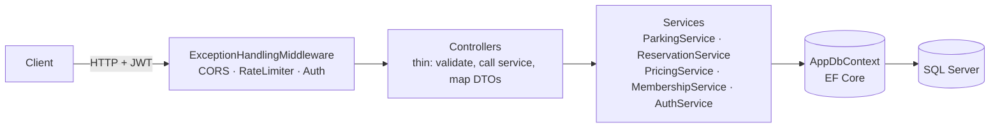

# ParkDesk API

> Parking lot operations backend: race-free spot assignment, capacity-aware reservations and real-world pricing rules.

[](https://github.com/edu-tech220/parkdesk-api/actions/workflows/ci.yml)


## 📌 Overview

ParkDesk is a REST API for running a parking facility: vehicle check-in and check-out, time-slot
reservations, tariffs with a grace period and a daily cap, membership discounts and overstay
fees.

It is not a sample CRUD. The core of the project is guaranteeing that **the same physical spot is
never assigned to two vehicles** when entry requests arrive at the same time, and that
reservations never exceed the lot's real capacity.

A parking operation needs three things a plain CRUD does not give you:

1. **Safe spot assignment under concurrency.** When two operators register an entry almost
   simultaneously and only one spot is left, exactly one of them gets it — without locking the
   database and without a silent race condition (the other request fails with a clear error).
2. **Reservations backed by real capacity.** A customer reserves a spot *type* (Regular, Compact,
   Electric, Disabled) for a future time window. The system rejects a reservation when the
   overlapping reservations already use every physical spot of that type.
3. **Pricing with real business rules.** Free grace period, hourly rate rounded up, daily cap,
   active-membership discount and an overstay fee when checkout happens after the reserved window.

## ✨ Key features and business rules

- **Concurrent check-in** — each vehicle type maps to compatible spot types in priority order
  (Car → Regular, Compact; Motorcycle → Compact, Regular; Electric → Electric, Regular). Free spots
  are claimed one by one with optimistic concurrency.
- **One active session per plate per lot** — a duplicate plate returns `409 Conflict`.
- **Overlap-based reservation capacity** — overlapping `Pending`/`CheckedIn` reservations of the
  same type are counted against the number of spots of that type.
- **Lazy reservation expiry** — a no-show reservation becomes `Expired` 30 minutes after its start
  time; drivers cannot check in more than 30 minutes early.
- **Reservation lifecycle** — `Pending → CheckedIn → Completed`, or `Cancelled` / `Expired`.
- **Pricing** — grace minutes → hourly rounding → daily cap → membership discount → overstay fee.
- **Memberships** — three seeded plans (0%, 15%, 30% discount); a user can hold only one active
  membership, and the best active discount is applied at checkout.
- **Role-based access** — `Admin`, `Operator`, `Customer` via JWT role claims.
- **Login rate limiting** and **paginated** listings for sessions and reservations.

## 🏗️ Architecture

A .NET 8 solution with two projects: the API and an xUnit test project.



- **Entities/** — domain model (`ParkingLot`, `ParkingSpot`, `Tariff`, `ParkingSession`,
  `Reservation`, `MembershipPlan`, `UserMembership`, `User`).
- **Data/** — `AppDbContext` (EF Core configuration) and `DbSeeder` (admin, operator, membership
  plans and a sample lot).
- **Services/** — all business logic lives here, not in the controllers:
  - `ParkingService` — concurrent spot assignment, check-in/check-out.
  - `ReservationService` — overlap-based capacity, reservation expiry.
  - `PricingService` — pure pricing calculation (no EF dependency, fully unit-testable).
  - `AuthService` / `Pbkdf2PasswordHasher` — registration, login and password hashing.
  - `MembershipService` — membership subscriptions.
- **Controllers/** — thin: validate the model, call the service, map to DTOs.
- **Common/** — `PagedResult<T>`, domain exceptions and the error-handling middleware.

## 🧠 Technical decisions

### Concurrency: application-managed token instead of `rowversion`

`ParkingSpot.ConcurrencyStamp` is a `Guid` configured with `IsConcurrencyToken()` rather than a
native SQL Server `rowversion`. `rowversion` only works on SQL Server, and the tests run on
SQLite, so the project needed optimistic concurrency that EF Core translates identically on any
provider. The token is regenerated on every write, and EF Core issues
`UPDATE ... WHERE Id = @id AND ConcurrencyStamp = @stamp` — if another transaction already
changed the row, zero rows are affected and EF throws `DbUpdateConcurrencyException`.

`ParkingService.AssignSpotAsync` builds on this: it loads the free spots of a type (ordered by
code) and tries to claim them one at a time. Losing the race for one spot is not a failure — the
service simply moves on to the next candidate. "No spots available" is returned only when none is
actually free. `ParkingConcurrencyTests` fires **10 simultaneous check-ins against a lot with 3
spots** and asserts that exactly 3 succeed, on distinct spots, with a consistent occupied count.

### Reservations: capacity by overlap, not "one hold per spot"

Unlike a ticketing system that holds a specific seat, a reservation here commits a spot **type**
for a time window, not a physical spot. The physical spot is assigned at check-in using the same
optimistic-concurrency mechanism. When a reservation is created, the service counts the
`Pending`/`CheckedIn` reservations of the same type whose window overlaps the requested one; if
that count already equals the number of spots of that type, the request is rejected with
`409 Conflict`. Stale reservations are marked `Expired` lazily (when read or listed), so no
`BackgroundService` has to poll the database.

### Pricing: a pure, testable function

`PricingService.Calculate` never touches the database: it takes a tariff and timestamps and
returns the base amount, the overstay fee and the total. Rules are applied in order: free grace
minutes → round up to whole hours → daily cap → membership discount → overstay fee (a percentage
of the hourly rate per started hour past the reserved end time). Being pure, it is tested
exhaustively without `WebApplicationFactory` or a database.

### Authentication and authorization

JWT with role claims (`Admin`, `Operator`, `Customer`). Passwords are hashed with
PBKDF2-SHA256 (100,000 iterations).

| Action | Role |
|---|---|
| Manage lots, spots and tariffs | `Admin` |
| Register entries/exits and reservation check-ins | `Admin`, `Operator` |
| Create/cancel reservations and subscribe to a membership | `Customer` (resource owner) |
| Browse lots, spots and tariffs | public |

### Rate limiting and CORS

`POST /api/auth/login` is protected by a fixed-window limiter (`RateLimiting:Login:PermitLimit`,
5 attempts per minute by default) to slow down brute-force attempts. The limit is read lazily
from configuration so integration tests, which log in many times, are not affected;
`RateLimitingTests` checks the real `429` behavior with a low limit injected only for that test.
CORS is open by default and restricted in production via `Cors:AllowedOrigins`.

### Errors as `ProblemDetails`

Every domain exception derives from `ApiException` and declares its own HTTP status
(`NotFoundException` → 404, `ConflictException` → 409, `BusinessRuleException` → 422,
`UnauthorizedException` → 401). `ExceptionHandlingMiddleware` turns them into a consistent
`application/problem+json` body; any unexpected exception becomes a 500 without leaking internal
details.

## 🧰 Tech stack

| Area | Technology |
|---|---|
| Language / runtime | C# · .NET 8 |
| Web | ASP.NET Core Web API (controllers), Swagger / OpenAPI (Swashbuckle) |
| Data access | Entity Framework Core 8 (code-first migrations) |
| Database | SQL Server 2022 (SQLite in tests) |
| Security | JWT Bearer, PBKDF2-SHA256, ASP.NET Core rate limiting |
| Testing | xUnit, FluentAssertions, `WebApplicationFactory` |
| DevOps | Docker, Docker Compose, GitHub Actions |

## 🚀 Getting started

### With Docker (API + SQL Server)

```bash
docker compose up --build
```

The API listens on `http://localhost:8080` (the compose file runs it in the `Production`
environment, so Swagger is disabled there). On startup it applies EF Core migrations against SQL
Server and seeds sample data:

- Admin user: `admin@parkdesk.local` / `Admin123!`
- Operator user: `operator@parkdesk.local` / `Operator123!`
- Three membership plans and a sample lot ("Plaza Centro") with spots and tariffs already set up.

> The credentials and signing key in `docker-compose.yml` and `appsettings.json` are development
> placeholders — change them before any real deployment.

### Locally (without Docker)

Requires the .NET 8 SDK and a reachable SQL Server instance (set
`ConnectionStrings:DefaultConnection` in `appsettings.json` or the
`ConnectionStrings__DefaultConnection` environment variable).

```bash
dotnet run --project src/ParkDesk.Api
```

With the default `http` launch profile the API runs on `http://localhost:5096`, and Swagger UI is
available at `http://localhost:5096/swagger` (Development environment).

### EF Core migrations

The initial migration is already included (`src/ParkDesk.Api/Migrations`). To add a new one after
changing the model:

```bash
dotnet tool restore
dotnet tool run dotnet-ef migrations add MigrationName -p src/ParkDesk.Api -o Migrations
```

## 🧪 Running tests

```bash
dotnet test
```

The suite has **25 tests** and needs **neither SQL Server nor Docker**: it uses in-memory SQLite
with a shared cache (`Mode=Memory;Cache=Shared`) through a custom `WebApplicationFactory<Program>`
(`ParkDeskWebApplicationFactory`). The schema is created with `EnsureCreated()` (SQL Server
migrations are not run against SQLite, to avoid incompatible column types) and seeded with the
same base data used in production.

| Area | File | What it covers |
|---|---|---|
| Unit | `Unit/PricingServiceTests.cs` | Grace period, rounding, daily cap, discount, overstay fee |
| Concurrency | `Integration/ParkingConcurrencyTests.cs` | 10 simultaneous check-ins vs. 3 free spots — no double assignment |
| Auth | `Integration/AuthFlowTests.cs` | Register, login, invalid credentials, role-protected endpoints |
| Sessions | `Integration/SessionsFlowTests.cs` | Check-in/check-out, duplicate plate, full lot, role restrictions |
| Reservations | `Integration/ReservationsFlowTests.cs` | Creation, overlap capacity conflict, check-in, cancellation, user isolation |
| Pagination | `Integration/PaginationTests.cs` | Paged listings |
| Rate limiting | `Integration/RateLimitingTests.cs` | `429` with a low limit injected only for that test |

CI (`.github/workflows/ci.yml`) restores, builds and tests the solution on every push and pull
request to `main`, uploads the test results, and then builds the Docker image.

## 📡 API endpoints

| Method | Route | Access |
|---|---|---|
| POST | `/api/auth/register` | Public |
| POST | `/api/auth/login` | Public (rate-limited) |
| GET | `/api/lots` | Public |
| GET | `/api/lots/{id}` | Public |
| POST | `/api/lots` | Admin |
| GET | `/api/lots/{lotId}/spots` | Public |
| POST | `/api/lots/{lotId}/spots` | Admin |
| GET | `/api/lots/{lotId}/tariffs` | Public |
| PUT | `/api/lots/{lotId}/tariffs` | Admin |
| POST | `/api/lots/{lotId}/sessions/checkin` | Admin, Operator |
| POST | `/api/sessions/{id}/checkout` | Admin, Operator |
| GET | `/api/sessions/{id}` | Admin, Operator |
| GET | `/api/sessions` | Admin, Operator (paginated) |
| POST | `/api/reservations` | Customer |
| GET | `/api/reservations/{id}` | Authenticated (owner, or Admin/Operator) |
| GET | `/api/reservations` | Authenticated (paginated; customers only see their own) |
| POST | `/api/reservations/{id}/checkin` | Admin, Operator |
| POST | `/api/reservations/{id}/cancel` | Reservation owner, or Admin/Operator |
| GET | `/api/memberships/plans` | Public |
| POST | `/api/memberships/subscribe` | Customer |

`src/ParkDesk.Api/ParkDesk.Api.http` contains ready-to-run sample requests.

## 📁 Project structure

```
.
├── .github/workflows/ci.yml       # Build, test and Docker image build
├── Dockerfile                     # Multi-stage build, runs as non-root user on port 8080
├── docker-compose.yml             # API + SQL Server 2022
├── ParkDesk.slnx
├── src/ParkDesk.Api/
│   ├── Common/                    # ApiException hierarchy, error middleware, PagedResult<T>
│   ├── Controllers/               # Auth, ParkingLots, ParkingSpots, Tariffs, Sessions, Reservations, Memberships
│   ├── Data/                      # AppDbContext, DbSeeder
│   ├── Dtos/                      # Request/response contracts per resource
│   ├── Entities/                  # Domain model and enums
│   ├── Migrations/                # EF Core migrations
│   ├── Services/                  # Business logic (parking, reservations, pricing, auth, memberships)
│   └── Program.cs
└── tests/ParkDesk.Api.Tests/
    ├── Infrastructure/            # WebApplicationFactory, auth helpers, test setup
    ├── Integration/               # End-to-end API flows, concurrency, rate limiting
    └── Unit/                      # PricingService tests
```
